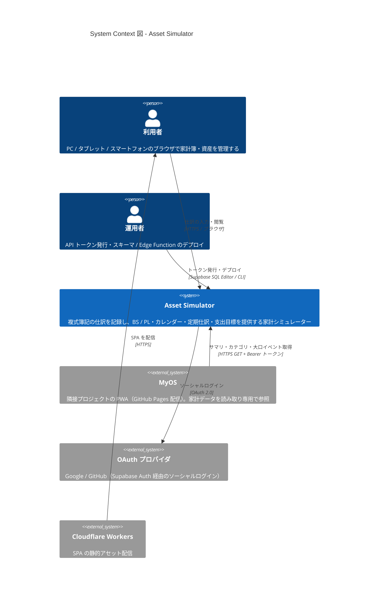

# Asset Simulator

## アーキテクチャ概要

複式簿記の仕訳を記録し、貸借対照表・損益計算書を表示する家計・資産シミュレーター。
React SPA（Cloudflare Workers 配信）が Zustand ストア経由で Supabase に直接アクセスするサーバーレス構成。

Container 図・Component 図・データフローの詳細は [docs/architecture.md](docs/architecture.md) を参照。

## ドキュメント

- [CLAUDE.md](CLAUDE.md) — 開発ルール・構成の要約
- [docs/README.md](docs/README.md) — 設計ドキュメント索引
- [.github/CONTRIBUTING.md](.github/CONTRIBUTING.md) — Issue / ブランチ / PR 運用
