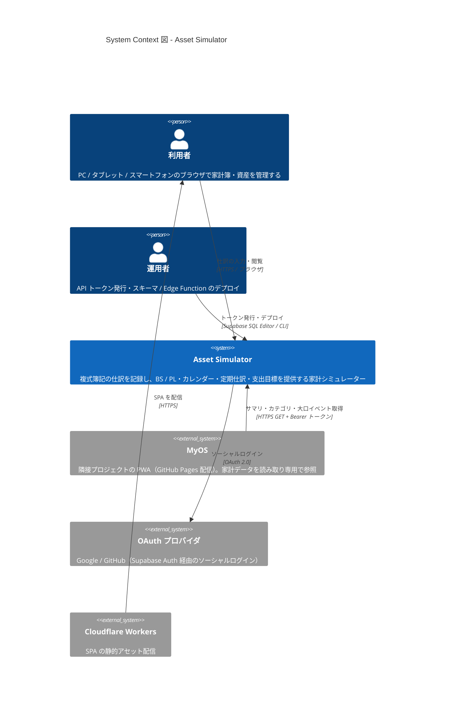
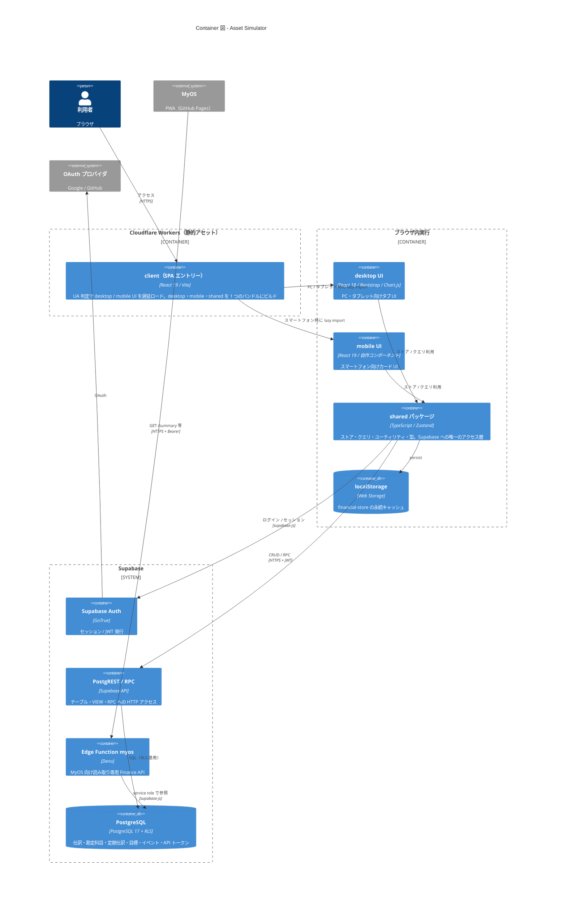
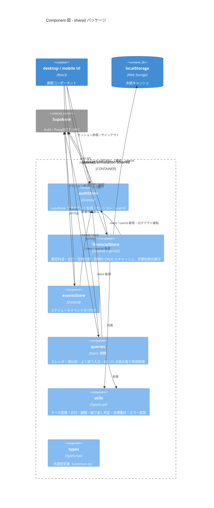
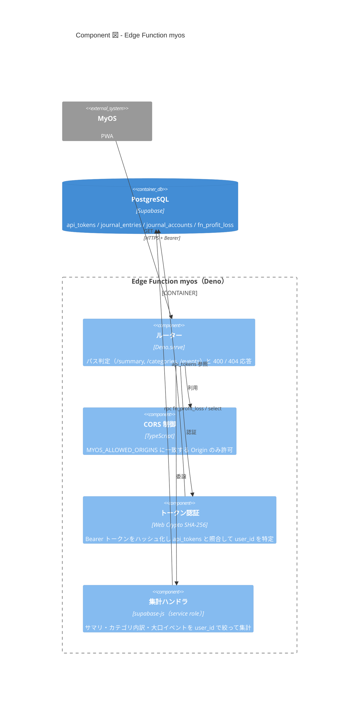
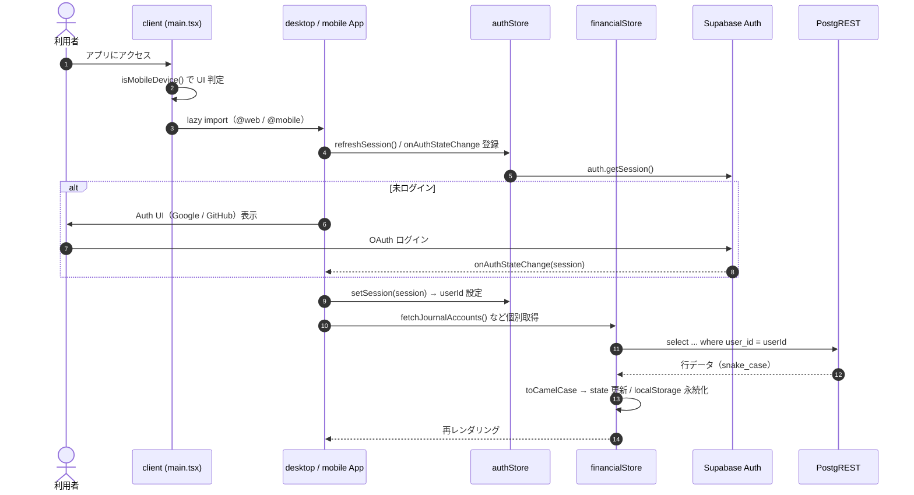
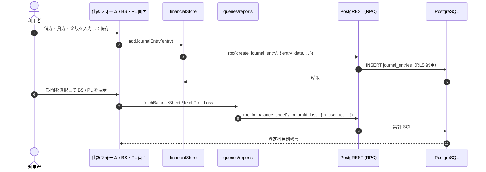
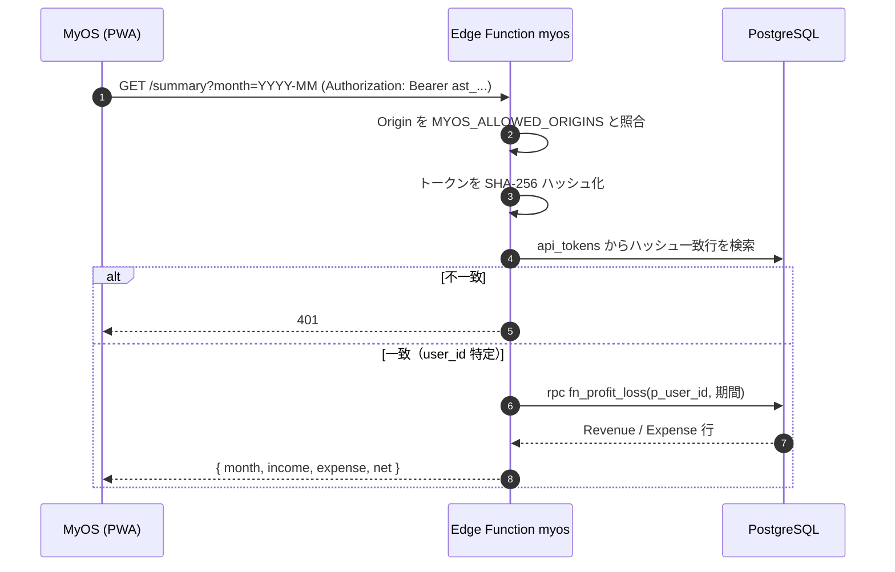

# アーキテクチャ（C4 モデル）

> 本書はリポジトリ内のコード・設定ファイルを確認して作成した C4 モデルのアーキテクチャ図です。
> コードから確認できなかった事項は「未確認」と明記しています。
> より詳細な設計は [`docs/architecture/overview.md`](architecture/overview.md) および [`docs/README.md`](README.md) の各ドキュメントを参照してください。

## 概要

### アプリの目的

家計・資産のシミュレーターアプリ。複式簿記の仕訳（借方・貸方）を記録し、貸借対照表（BS）・損益計算書（PL）、カレンダー、定期仕訳、支出目標、スケジュールイベントを管理・表示する。

### 主な利用者

| 利用者 | 説明 |
|-------|------|
| 一般利用者（本人） | ブラウザ（PC / タブレット / スマートフォン）から Supabase Auth でログインし、自分の仕訳・勘定科目を管理する。データは `user_id` 単位で RLS により分離される |
| MyOS（隣接プロジェクト） | 別リポジトリの PWA。本システムの Edge Function `myos` から API トークン認証で家計データを**読み取り専用**で参照する |
| 運用者（開発者） | Supabase SQL Editor から API トークンを発行（`fn_issue_api_token`）し、スキーマ・Edge Function をデプロイする |

### 技術スタック

| 分類 | 技術 | 根拠 |
|-----|------|------|
| モノレポ | npm workspaces + Turborepo | `package.json`, `turbo.json` |
| エントリーポイント | React 19 + Vite 8 + TypeScript | `client/package.json`, `client/vite.config.ts` |
| PC / タブレット UI | React 18 + Create React App（react-scripts 5）, Bootstrap 5, Chart.js, react-calendar | `desktop/package.json` |
| モバイル UI | React 19 + Vite, 自作コンポーネントライブラリ, Storybook 10 | `mobile/package.json`, `mobile/app/` |
| 状態管理 | Zustand 5（`persist` で localStorage 永続化） | `packages/shared/package.json`, `financialStore.ts` |
| BaaS | Supabase（PostgreSQL 17, PostgREST, RPC, Auth, Edge Functions） | `supabase/config.toml`, `@supabase/supabase-js` |
| 認証 | Supabase Auth + `@supabase/auth-ui-react`（OAuth: Google / GitHub） | `desktop/src/App.tsx`, `mobile/app/src/LoginScreen.tsx` |
| サーバーレス関数 | Supabase Edge Function（Deno） | `supabase/functions/myos/index.ts` |
| ホスティング | Cloudflare Workers Static Assets（`client/dist` を SPA 配信） | `client/wrangler.jsonc` |
| テスト | Jest + ts-jest（`packages/shared`）、React Testing Library（`desktop`） | `jest.config.cjs`, 各 `package.json` |
| ローカル開発 | Supabase CLI + Docker（`supabase start`） | `docs/database/development_policy.md`, `supabase/config.toml` |
| CI/CD | **未確認**（`.github/workflows` は存在しない。Cloudflare の Git 連携で `wrangler deploy` を実行する旨が `client/wrangler.jsonc` のコメントにあるが、設定本体はリポジトリ外） | — |
| IaC / Dockerfile | なし（Supabase CLI の Docker 利用のみ） | — |

---

## Level 1: System Context 図



| 名前 | 種別 | 技術 | 責務 |
|-----|------|------|------|
| 利用者 | Person | ブラウザ | 仕訳・勘定科目・定期仕訳・目標・イベントの登録と BS / PL の閲覧 |
| 運用者 | Person | Supabase SQL Editor / Supabase CLI / Wrangler | `fn_issue_api_token` による MyOS 用トークン発行、`supabase db push`・`supabase functions deploy` |
| Asset Simulator | Software System | React SPA + Supabase | 本システム。家計データの記録・集計・表示 |
| MyOS | External System | PWA（GitHub Pages） | Edge Function `myos` から読み取り専用でデータを取得（実装は別リポジトリのため詳細は未確認） |
| OAuth プロバイダ | External System | Google / GitHub | Supabase Auth のソーシャルログイン先（Supabase 側のプロバイダ有効化設定はリポジトリ外のため未確認） |
| Cloudflare Workers | External System | Workers Static Assets | `client/dist` を SPA として配信（`not_found_handling: single-page-application`） |

---

## Level 2: Container 図



| 名前 | 種別 | 技術 | 責務 |
|-----|------|------|------|
| client（SPA エントリー） | Container | React 19 / Vite 8 / Wrangler | `client/src/main.tsx` が `isMobileDevice()` で UI を振り分け。Vite alias（`@web` / `@mobile` / `@mobile-components` / `@asset-simulator/shared`）で他ワークスペースのソースを取り込みビルドし、`dist/` を Cloudflare Workers にデプロイ |
| desktop UI | Container（ブラウザ内） | React 18 / CRA / Bootstrap / Chart.js / react-calendar | タブ（ダッシュボード・取引・マスタ・定期取引・イベント）による PC / タブレット UI。単体でも `react-scripts` でビルド・`serve` で起動可能 |
| mobile UI | Container（ブラウザ内） | React 19 / Vite / Storybook | タブ（取引・PL/BS・定期取引・勘定科目）によるスマートフォン UI。`mobile/components` は Storybook 対象のコンポーネントライブラリ |
| shared パッケージ | Container（ライブラリ） | TypeScript / Zustand 5 / supabase-js | `@asset-simulator/shared`。Supabase クライアント生成、ストア、読み取りクエリ、ユーティリティ、型定義 |
| localStorage | Data Store | Web Storage | `financial-store` キーで勘定科目・定期仕訳・目標をキャッシュ（`persist` の `version` 管理あり） |
| Supabase Auth | Container（マネージド） | Supabase Auth | OAuth（Google / GitHub）ログイン・セッション管理 |
| PostgREST / RPC | Container（マネージド） | Supabase API | テーブル / VIEW への CRUD、`create_journal_entry`・`fn_balance_sheet`・`fn_profit_loss`・`save_goal` RPC |
| Edge Function `myos` | Container | Deno / supabase-js | `/summary`・`/categories`・`/events` を提供。`api_tokens` の SHA-256 ハッシュで Bearer 認証。`MYOS_ALLOWED_ORIGINS` で CORS 制御 |
| PostgreSQL | Database | PostgreSQL 17 / RLS | テーブル: `journal_accounts`, `journal_entries`, `regular_journal_entries`, `schedule_events`, `goals`, `goal_accounts`, `api_tokens`。VIEW: `v_balance_sheet`, `v_profit_loss_statement`, `v_journal_entries_for_calendar`, `v_journal_entries2` |

> 補足: 旧 API サーバー（Express）は廃止済みで、リポジトリには存在しない。定期仕訳の実行はサーバー側バッチではなく、UI 操作時にクライアント（`executeDueRegularJournalEntries`）から実行される。DB 側の定期ジョブ（pg_cron 等）は `supabase/schemas` 内に確認できない。

---

## Level 3: Component 図

中心となるコンテナは、両 UI が共通利用し Supabase への唯一のアクセス層である **shared パッケージ** と、MyOS 連携の **Edge Function `myos`** の 2 つ。

### 3-1. shared パッケージ（`packages/shared/src`）



| 名前 | 種別 | 技術 | 責務 |
|-----|------|------|------|
| authStore | Component | Zustand / supabase-js | `REACT_APP_SUPABASE_URL` / `REACT_APP_SUPABASE_ANON_KEY` から Supabase クライアントを生成し、`session` / `userId` を保持 |
| financialStore | Component | Zustand + `persist` | `journal_accounts` / `journal_entries` / `regular_journal_entries` / `goals` の CRUD、`create_journal_entry`・`save_goal` RPC、定期仕訳の実行。ログアウト検知でキャッシュクリア |
| eventsStore | Component | Zustand | `schedule_events` の CRUD |
| queries | Component | async 関数 | `fetchCalendarJournalEntries`（`v_journal_entries_for_calendar`）、`fetchFrequentEntrySets`、`fetchBalanceSheet`（`fn_balance_sheet`）、`fetchProfitLoss`（`fn_profit_loss`） |
| utils | Component | TypeScript | `caseConvert` / `dateUtils` / `period` / `recurrence` / `goals` / `frequentEntries` / `balanceSheet` / `supabaseError`。Jest のユニットテスト対象 |
| types | Component | TypeScript | 型定義のみ（`common.ts`） |

### 3-2. Edge Function `myos`（`supabase/functions/myos/index.ts`）



| 名前 | 種別 | 技術 | 責務 |
|-----|------|------|------|
| ルーター | Component | `Deno.serve` | リクエストのパス・メソッド判定、クエリパラメータ（`month` / `date` / `range` / `min_amount`）検証 |
| CORS 制御 | Component | TypeScript | 環境変数 `MYOS_ALLOWED_ORIGINS` に含まれるオリジンにのみ CORS ヘッダを付与 |
| トークン認証 | Component | SHA-256 | 平文トークンは保存せず、ハッシュ照合で `user_id` を解決。失敗時 401 |
| 集計ハンドラ | Component | supabase-js（`SUPABASE_SERVICE_ROLE_KEY`） | RLS をバイパスするため、`p_user_id` / `user_id` フィルタを必ず指定して集計 |

※ Edge Function 内部の関数分割は上記の責務単位で整理したもの。詳細は [`docs/api/myos_integration.md`](api/myos_integration.md) を参照。

---

## 主要なデータフロー

### 1. ログインと初期データ取得



### 2. 仕訳の登録と BS / PL の表示



### 3. MyOS からの読み取り



---

## ディレクトリ構成

```
asset-simulator/
├── client/                 # SPA エントリーポイント（Vite）。デバイス判定・Cloudflare 配信設定（wrangler.jsonc）
├── desktop/                # PC / タブレット版 UI（React 18 + CRA）
│   └── src/components/     # journal/（仕訳・定期取引・勘定科目）, event/, common/, MainCalendar
├── mobile/                 # モバイル版（React 19 + Vite + Storybook）
│   ├── app/src/            # モバイルアプリ本体（App.tsx と各カード・LoginScreen）
│   ├── components/         # 共通 UI コンポーネントライブラリ（Storybook 対象）
│   ├── src/                # Storybook 用スキャフォールド（アプリ本体ではない）
│   └── docs/               # モバイル UI 関連ドキュメント
├── packages/
│   └── shared/             # @asset-simulator/shared（types / utils / stores / queries）
├── supabase/
│   ├── config.toml         # Supabase CLI ローカル設定（PostgreSQL 17）
│   ├── schemas/            # 宣言的スキーマ（tables / views / functions / policies / triggers / grants）
│   ├── migrations/         # マイグレーション SQL
│   ├── functions/myos/     # MyOS 向け Edge Function（Deno）
│   └── seed.sql            # ローカル用シード
├── docs/                   # 設計ドキュメント（本書を含む）
├── .github/                # Issue / PR テンプレート・CONTRIBUTING（CI ワークフローはなし）
├── .claude/                # Claude Code 設定
├── .mcp.json               # Supabase MCP（staging / prod 読み取り専用）接続設定
├── turbo.json              # Turborepo タスク定義
├── jest.config.cjs         # ルート Jest 設定
└── package.json            # npm workspaces（desktop / packages/* / client）
```

| ディレクトリ | 役割 |
|-------------|------|
| `client/` | 本番配信されるエントリー。desktop / mobile / shared のソースを Vite alias で束ねて 1 つの SPA にビルドする |
| `desktop/` | PC / タブレット向け画面。CRA 単体でも起動可能 |
| `mobile/` | スマートフォン向け画面とコンポーネントライブラリ。npm workspaces には含まれず、個別に `npm install` する構成 |
| `packages/shared/` | 状態管理と Supabase アクセスを集約する共有ライブラリ |
| `supabase/` | DB スキーマ・RPC・RLS・Edge Function を Single Source of Truth として管理 |
| `docs/` | 設計ドキュメント群（索引は [`docs/README.md`](README.md)） |

## 未確認事項

- CI/CD パイプライン（GitHub Actions は存在しない。Cloudflare 側の Git 連携設定・ビルドコマンドはリポジトリ外）
- Supabase 本番プロジェクトの Auth プロバイダ設定・Edge Function のデプロイ状況
- MyOS 側の実装（別リポジトリ）
- 監視・ログ収集基盤（リポジトリ内に設定なし）
